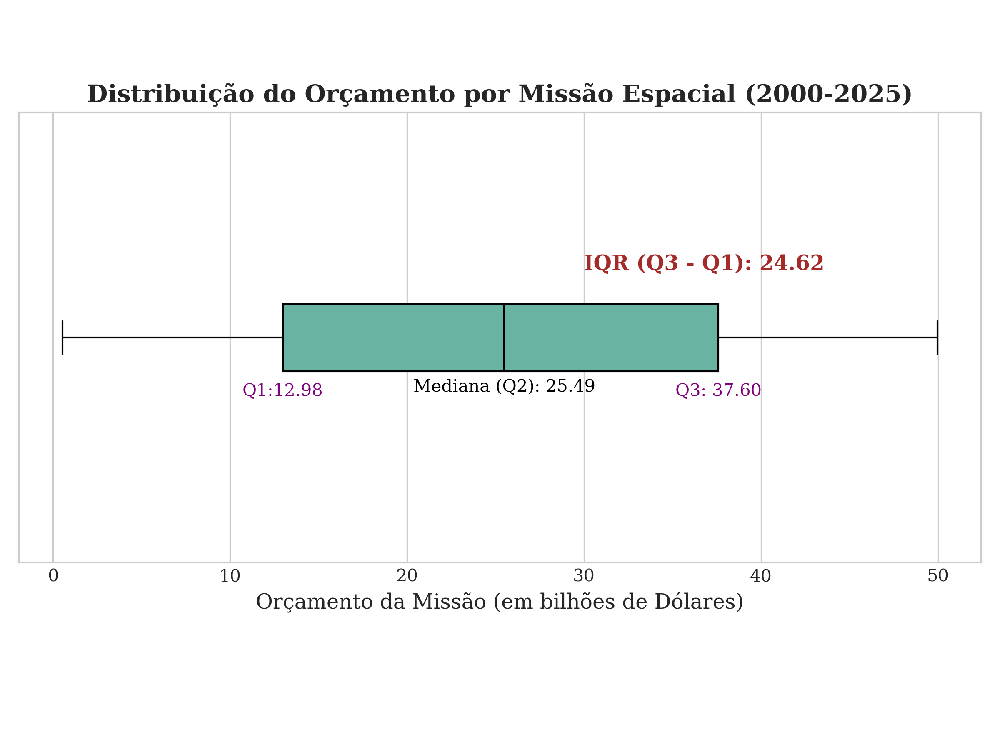

# Exploração espacial em dados

**Análise exploratória · Python · Estatística descritiva · Visualização**

Estudo acadêmico de missões espaciais entre **2000 e 2025**, com foco na distribuição de orçamentos, duração das missões e comparação entre países e tipos de satélite.

> **Dados simulados.** O conjunto é fictício e serve ao aprendizado de análise de dados. Seus resultados não descrevem investimentos ou missões reais.

## O que explorar

| Pergunta | Abordagem |
|---|---|
| Como o orçamento varia entre categorias? | Boxplots, quartis e identificação de valores extremos |
| Como os orçamentos se distribuem ao longo do tempo? | Agrupamentos por país, ano e tipo de satélite |
| Qual a relação entre orçamento e duração? | Análise de dispersão |
| Quais categorias aparecem com maior frequência? | Contagens e comparação de distribuições |

## Visualização do estudo

## Navegar pelo projeto

- [Código das análises](code/)
- [Dataset CSV](Data/Global_Space_Exploration_Dataset.csv)
- [Relatório acadêmico: contexto, método e discussão](docs/Readme.me)
- [Gráficos exportados](images/)
- [Licença do código](docs/LICENSE)

**Ferramentas:** Python, pandas, Matplotlib, Seaborn e Plotly.

## Reprodução e estado atual

Os scripts ficam em `code/` e o CSV em `Data/`. Antes de executar, ajuste os caminhos de leitura nos scripts: há referências absolutas ao computador de desenvolvimento. Por exemplo, `code/grafico_1.py` lê o CSV por um caminho local do Windows.

O projeto ainda não possui arquivo de dependências com versões fixadas nem execução automatizada validada. As imagens e o relatório permitem consultar o estudo sem executar os scripts.

## Autoria

Arthur Braulino, Guilherme Sabo, Nicolas Soares e Pedro Barreto.  
Fatec Cotia · Ciência de Dados.
